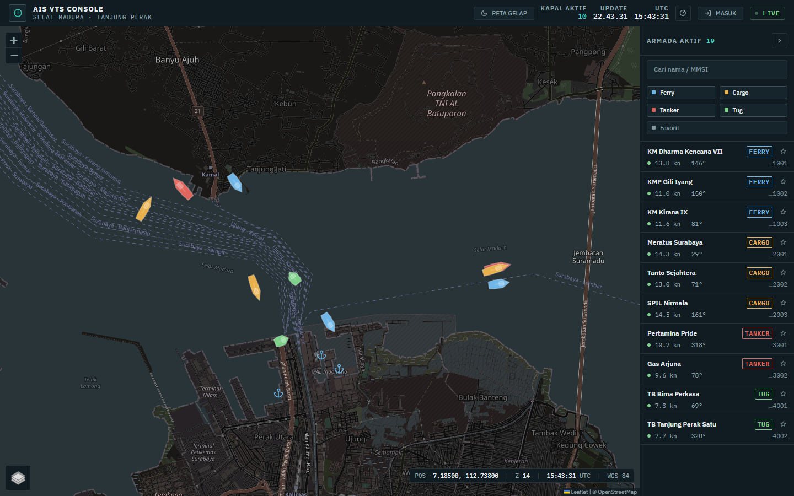
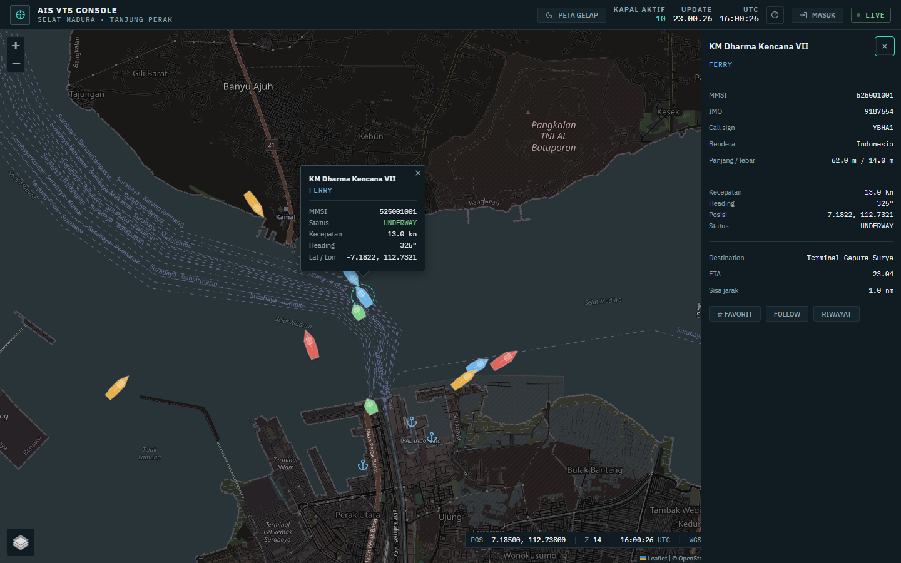

# AIS VTS Console



Konsol monitoring pergerakan kapal **AIS (Automatic Identification System)** simulasi
di perairan **Selat Madura & Pelabuhan Tanjung Perak, Surabaya**. Real-time via
Socket.io, riwayat posisi di MongoDB, data statis armada di PostgreSQL, peta Leaflet.

Dibangun sebagai proyek pembelajaran (PKL) Teknik Perkapalan: seluruh kapal adalah
simulasi virtual, bukan feed AIS asli.

---

## Fitur

- **Live tracking**: 10 kapal virtual bergerak dengan fisika nyata (knot ke m/detik,
  delta-time, koreksi bujur), rotasi marker mengikuti heading, jejak polyline per kapal.
- **Search nama / MMSI**: kotak cari di sidebar dengan navigasi keyboard
  (ArrowDown / ArrowUp memilih, Enter membuka detail, Esc mengosongkan).
- **Drawer detail + voyage**: klik kapal (daftar atau marker) membuka panel kanan
  berisi particulars (IMO, call sign, flag, dimensi), data live, dan voyage:
  destination, ETA, serta sisa jarak dalam mil laut yang dihitung dari rute aktif.
- **Favorites & follow**: bintang per kapal dan filter chip Favorit, tersimpan di
  localStorage. FOLLOW membuat peta mengikuti kapal terpilih tiap tick.
- **Riwayat + playback**: track riwayat dari MongoDB (default 6 jam terakhir; titik
  anomali dibuang speed-gate, gap data tidak ditarik garis), slider waktu atau
  play (1x / 4x / 16x) untuk memutar ulang.
- **Deep link**: `?ship=<mmsi>` membuka detail + riwayat kapal langsung saat load;
  opsional `from` / `to` (ISO 8601) untuk membatasi rentang waktu.
- **Auth + CRUD kapal**: register / login dengan peran `admin` dan `operator`.
  Admin mengelola seluruh armada; operator hanya kapal miliknya. Tambah / edit kapal
  lewat form dengan editor rute klik-peta (klik peta menambah waypoint, undo / clear),
  hapus dua langkah. Perubahan langsung live lewat Socket.io `fleet:update`,
  tanpa restart server.
- **Filter jenis kapal**: Ferry / Cargo / Tanker / Tug; marker, jejak, dan daftar ikut.
- **Status sandar**: ferry & tug berhenti sebentar di terminal ujung rute (MOORED).
- **Indikator koneksi**: badge LIVE berubah OFFLINE saat socket putus, toast saat reconnect.
- **Palet warna**: switcher 4 palet flat (sonar teal default, phosphor green, amber,
  chart terang) plus tema peta gelap / terang / satelit Esri. Pilihan tersimpan lokal.
- **Responsif**: sidebar kanan di desktop, panel bawah di mobile; topbar icon-only
  di layar sempit.



Screenshot palet: [sonar](docs/screenshots/v21-palette-sonar.png) ·
[phosphor](docs/screenshots/v21-palette-phosphor.png) ·
[amber](docs/screenshots/v21-palette-amber.png) ·
[chart](docs/screenshots/v21-palette-chart.png) ·
[mobile 390px](docs/screenshots/v21-mobile.png)

## Tech stack

| Layer | Teknologi |
|---|---|
| Backend | Node.js, Express 4, Socket.io 4 |
| Data statis | PostgreSQL (`pg`): tabel `ships`, `routes`, `ports`, `users`, `sessions` |
| Riwayat posisi | MongoDB (Mongoose): compound index + TTL retensi |
| Auth | `node:crypto` scrypt + session cookie HttpOnly (tanpa dependensi tambahan) |
| Frontend | Vanilla JS (ES modules), Leaflet 1.9.4, CSS design tokens |
| Tipografi | IBM Plex Sans + IBM Plex Mono |
| Test | `node:test` (tanpa dependensi tambahan) |

Tanpa build step, tanpa framework frontend, tanpa API key peta.

## Arsitektur

```
                 ┌────────────────────────────┐
                 │  Browser (Leaflet + ES mod) │
                 └───────┬────────────▲───────┘
                    REST │            │ Socket.io "ships:update" (2s)
                 ┌───────▼────────────┴───────┐
                 │  Express + Socket.io server │
                 │ routes/api · routes/auth    │
                 │ services/fleet · voyage     │
                 └──┬──────────┬───────────┬──┘
        load start  │          │ insert 10s │ merge
                 ┌──▼───┐  ┌───▼────┐  ┌───▼────────┐
                 │ PG   │  │ Mongo  │  │ simulator  │
                 │ships │  │positions│ │ (dinamika) │
                 │routes│  │ +TTL   │  └───▲────────┘
                 │users │  └────────┘      │ upsert/remove
                 └──────┘            CRUD kapal (live)
```

`data/fleet.js` adalah sumber data statis awal (dipakai seeder dan fallback simulator).
Saat server start, armada di-load dari PostgreSQL (ships + routes); payload REST dan
Socket.io di-merge oleh fungsi yang sama sehingga selalu konsisten. CRUD kapal
meng-update tabel PG, cache statis, dan simulator sekaligus, lalu memancarkan
`fleet:update` ke semua client. Bila database mati, server tetap berjalan dengan
data lokal (riwayat dan auth nonaktif, pesan error yang jelas di UI).

## Menjalankan

Prasyarat: Node.js 18+, PostgreSQL, MongoDB (lokal via FlyEnv/Laragon, atau Atlas).

```bash
git clone https://github.com/rafifandriyanto/belajar-ais.git
cd belajar-ais
npm install
cp .env.example .env        # isi MONGODB_URI & DATABASE_URL
npm run seed                # tabel + 10 kapal + rute + particulars + 3 pelabuhan
npm run dev                 # auto-reload, atau: npm start
```

Buka **http://localhost:3000**.

`npm run seed` idempotent: selain kapal dan pelabuhan, ia mengisi tabel `routes`
(waypoints, speed, dwell) dan particulars (IMO, call sign, flag, dimensi, destination)
yang dipakai drawer detail dan perhitungan voyage. Bila `ADMIN_USERNAME` /
`ADMIN_PASSWORD` disetel di `.env`, seed membuat akun admin tersebut; bila tidak,
pendaftar pertama di web menjadi admin.

> Tanpa MongoDB/PostgreSQL pun app tetap jalan: data statis fallback ke
> `data/fleet.js`, panel riwayat dan form auth menampilkan pesan bahwa database
> belum tersedia.

Variabel `.env` opsional: `POSITION_TTL_DAYS` (retensi riwayat, default 30 hari,
`0` = selamanya), `USE_PUBLIC_DNS` (bila SRV Atlas gagal resolve),
`ADMIN_USERNAME` / `ADMIN_PASSWORD` (akun admin awal saat seed).

## API

| Method | Endpoint | Deskripsi |
|---|---|---|
| GET | `/api/ships` | Posisi live + nama/tipe gabungan (PG + simulator) |
| GET | `/api/ships/:mmsi` | Particulars + voyage (sisa jarak, ETA) dari rute aktif |
| POST | `/api/ships` | Tambah kapal + rute (auth). Validasi MMSI 9 digit, bbox Selat Madura |
| PUT | `/api/ships/:mmsi` | Edit kapal / rute (auth; admin semua, operator miliknya) |
| DELETE | `/api/ships/:mmsi` | Hapus kapal (auth; rute cascade, riwayat ikut TTL) |
| GET | `/api/ships/:mmsi/history` | Riwayat posisi ascending. Param: `limit` (1-1000, default 100), `from`, `to` (ISO). MMSI wajib 9 digit |
| GET | `/api/ports` | Daftar pelabuhan (PG, fallback lokal) |
| POST | `/api/auth/register` | Daftar (username 3-24 karakter, password min 8). Pendaftar pertama = admin |
| POST | `/api/auth/login` | Masuk, set cookie session HttpOnly |
| POST | `/api/auth/logout` | Keluar, hapus session |
| GET | `/api/auth/me` | User aktif ({id, username, role}) atau null |

Socket.io: `ships:update` (array kapal merged) tiap 2 detik hanya bila ada client;
`fleet:update` dipancarkan setiap CRUD kapal berhasil.

## Test

```bash
npm test
```

Unit test `node:test`: bearing/haversine/destination-point, step fisika per detik,
sandar & balik arah di ujung rute, merge data statis+dinamis, validasi MMSI,
perhitungan voyage (sisa jarak + ETA), validasi payload kapal, CRUD simulator
(upsert/reset rute/remove), dan pencarian nama/MMSI.

## Struktur

```
├── data/fleet.js          # sumber data statis awal kapal & pelabuhan
├── simulator.js           # dinamika: fisika knot, delta-time, dwell, upsert/remove
├── services/fleet.js      # load statis dari PG + merge payload
├── services/voyage.js     # sisa jarak + ETA dari rute aktif
├── services/ship-validate.js # validasi payload kapal (MMSI, bbox, tipe, speed)
├── routes/api.js          # REST: ships, CRUD, history, ports
├── routes/auth.js         # register/login/logout/me, session scrypt, rate limit
├── db/postgres.js         # pool PG
├── db/seed.js             # seed idempotent: ships, routes, ports, admin opsional
├── models/Position.js     # Mongoose: compound index + TTL
├── server.js              # bootstrap, socket, interval, graceful shutdown
├── public/
│   ├── index.html
│   ├── css/console.css    # design tokens "VTS Console" + 4 palet
│   └── js/                # main, map, fleet, history, socket, util,
│                          # favorites, detail, auth, editor
├── scripts/               # helper CDP + verifikasi visual (tanpa dependensi)
├── test/                  # node:test
└── docs/screenshots/
```

## Lisensi

ISC — lihat [LICENSE](LICENSE).