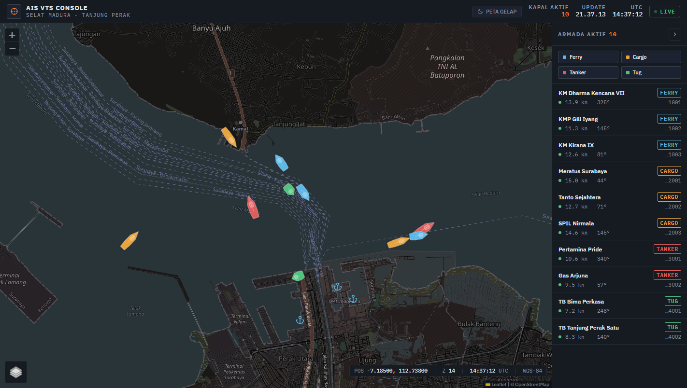
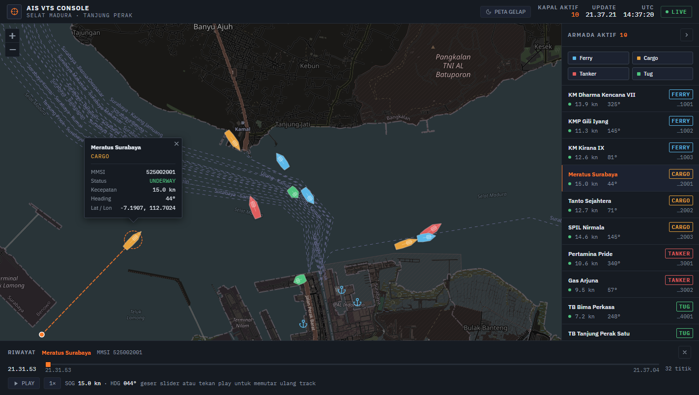

# AIS VTS Console



Konsol monitoring pergerakan kapal **AIS (Automatic Identification System)** simulasi
di perairan **Selat Madura & Pelabuhan Tanjung Perak, Surabaya** — real-time via
Socket.io, riwayat posisi di MongoDB, data statis armada di PostgreSQL, peta Leaflet.

Dibangun sebagai proyek pembelajaran (PKL) Teknik Perkapalan: seluruh kapal adalah
simulasi virtual, bukan feed AIS asli.

---

## Fitur

- **Live tracking** — 10 kapal virtual bergerak dengan fisika nyata (knot → m/detik,
  delta-time, koreksi bujur), rotasi marker mengikuti heading, jejak polyline per kapal.
- **Riwayat + playback** — klik kapal untuk membuka track riwayatnya dari MongoDB
  (default 6 jam terakhir; titik anomali dibuang speed-gate, gap data tidak ditarik
  garis), geser slider waktu atau tekan play (1×/4×/16×) untuk memutar ulang.
- **Deep link** — `?ship=<mmsi>` membuka riwayat kapal langsung saat load; opsional
  `from`/`to` (ISO 8601) untuk membatasi rentang waktu.
- **Filter jenis kapal** — Ferry / Cargo / Tanker / Tug; marker, jejak, dan daftar ikut.
- **Status sandar** — ferry & tug berhenti sebentar di terminal ujung rute (MOORED).
- **Indikator koneksi** — badge LIVE berubah OFFLINE saat socket putus, toast saat reconnect.
- **Tema peta** — gelap (default, OSM di-filter CSS, tanpa API key) / terang / satelit Esri.
- **Responsif** — sidebar kanan di desktop, panel bawah di mobile.



## Tech stack

| Layer | Teknologi |
|---|---|
| Backend | Node.js, Express 4, Socket.io 4 |
| Data statis | PostgreSQL (`pg`) — tabel `ships`, `ports` |
| Riwayat posisi | MongoDB (Mongoose) — compound index + TTL retensi |
| Frontend | Vanilla JS (ES modules), Leaflet 1.9.4, CSS design tokens |
| Tipografi | IBM Plex Sans + IBM Plex Mono |
| Test | `node:test` (tanpa dependensi tambahan) |

Tanpa build step, tanpa framework frontend, tanpa API key peta.

## Arsitektur

```
                 ┌────────────────────────────┐
                 │  Browser (Leaflet + ES mod) │
                 └───────┬────────────▲───────┘
                    REST │            │ Socket.io "ships:update" (2s)
                 ┌───────▼────────────┴───────┐
                 │  Express + Socket.io server │
                 │  routes/api · services/fleet│
                 └──┬──────────┬───────────┬──┘
        load start  │          │ insert 10s │ merge
                 ┌──▼───┐  ┌───▼────┐  ┌───▼────────┐
                 │ PG   │  │ Mongo  │  │ simulator  │
                 │ships │  │positions│ │ (dinamika) │
                 │ports │  │ +TTL   │  └───▲────────┘
                 └──────┘  └────────┘      │ fallback statis
                                      data/fleet.js
```

`data/fleet.js` adalah satu-satunya sumber data statis (dipakai seeder dan simulator).
Saat server start, nama/tipe kapal di-refresh dari PostgreSQL; payload REST dan
Socket.io di-merge oleh fungsi yang sama sehingga selalu konsisten. Bila database
mati, server tetap berjalan dengan data lokal (riwayat nonaktif).

## Menjalankan

Prasyarat: Node.js 18+, PostgreSQL, MongoDB (lokal via FlyEnv/Laragon, atau Atlas).

```bash
git clone https://github.com/rafifandriyanto/belajar-ais.git
cd belajar-ais
npm install
cp .env.example .env        # isi MONGODB_URI & DATABASE_URL
npm run seed                # buat tabel + isi 10 kapal & 3 pelabuhan
npm run dev                 # auto-reload, atau: npm start
```

Buka **http://localhost:3000**.

> Tanpa MongoDB/PostgreSQL pun app tetap jalan: data statis fallback ke
> `data/fleet.js`, panel riwayat menampilkan pesan bahwa database belum tersedia.

Variabel `.env` opsional: `POSITION_TTL_DAYS` (retensi riwayat, default 30 hari,
`0` = selamanya) dan `USE_PUBLIC_DNS` (bila SRV Atlas gagal resolve).

## API

| Method | Endpoint | Deskripsi |
|---|---|---|
| GET | `/api/ships` | Posisi live + nama/tipe gabungan (PG + simulator) |
| GET | `/api/ships/:mmsi/history` | Riwayat posisi ascending. Param: `limit` (1–1000, default 100), `from`, `to` (ISO). MMSI wajib 9 digit |
| GET | `/api/ports` | Daftar pelabuhan (PG, fallback lokal) |

Socket.io: event `ships:update` (array kapal merged) tiap 2 detik, hanya bila ada client.

## Test

```bash
npm test
```

Unit test `node:test`: bearing/haversine/destination-point, step fisika per detik,
sandar & balik arah di ujung rute, merge data statis+dinamis, validasi MMSI.

## Struktur

```
├── data/fleet.js          # sumber tunggal data statis kapal & pelabuhan
├── simulator.js           # dinamika: fisika knot, delta-time, dwell
├── services/fleet.js      # load statis dari PG + merge payload
├── routes/api.js          # REST: ships, history, ports
├── db/postgres.js         # pool PG
├── db/seed.js             # seed idempotent dari data/fleet.js
├── models/Position.js     # Mongoose: compound index + TTL
├── server.js              # bootstrap, socket, interval, graceful shutdown
├── public/
│   ├── index.html
│   ├── css/console.css    # design tokens "VTS Console"
│   └── js/                # main, map, fleet, history, socket, util
├── test/                  # node:test
└── docs/screenshots/
```

## Lisensi

ISC — lihat [LICENSE](LICENSE).