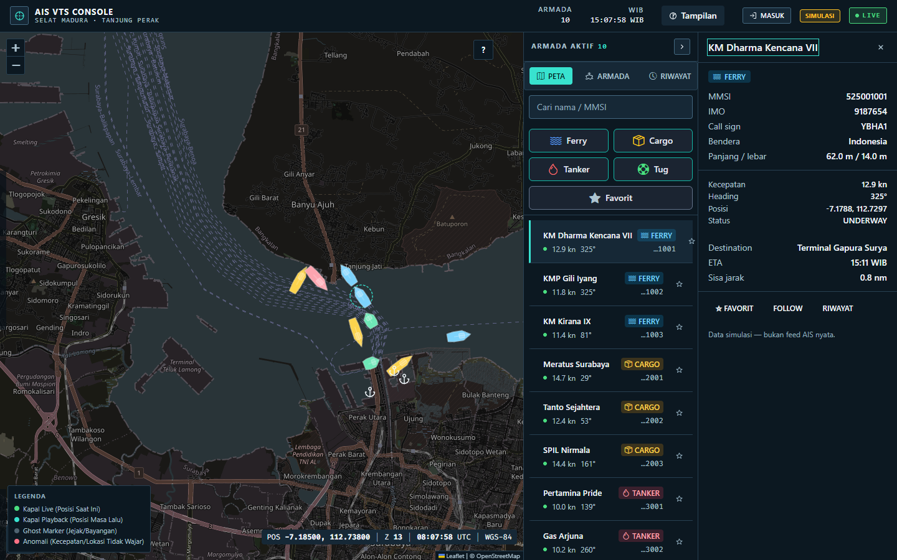
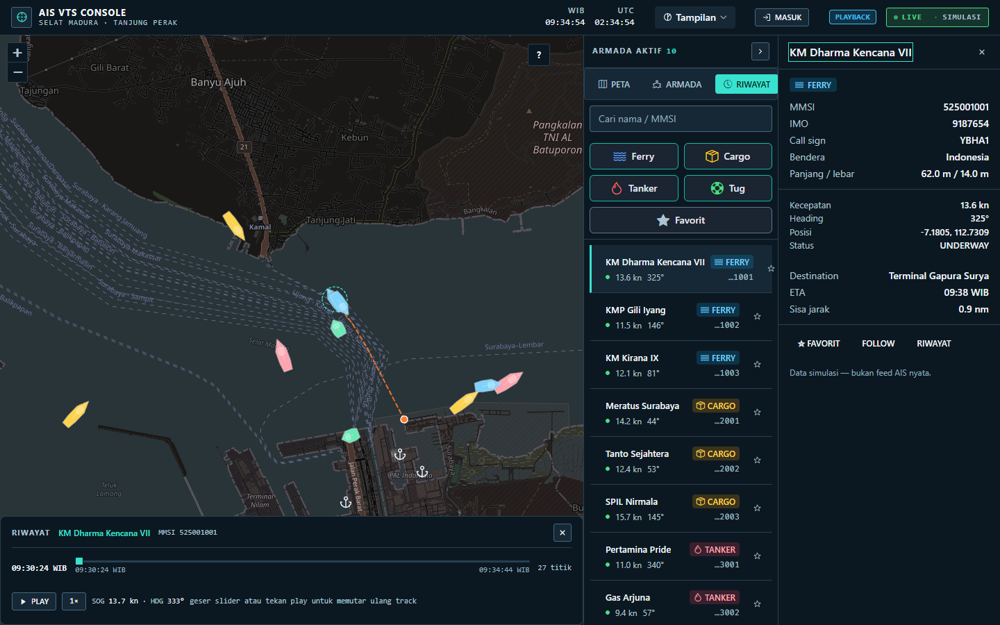
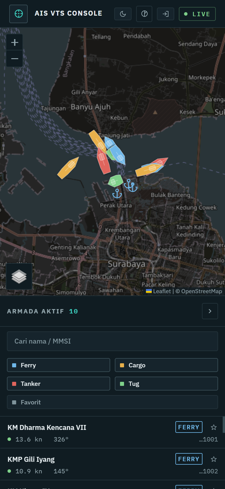

# AIS VTS Console


Konsol ini memantau pergerakan kapal di Selat Madura dan Pelabuhan Tanjung Perak, Surabaya. Kapalnya simulasi, dibuat untuk PKL Teknik Perkapalan. Posisi live lewat Socket.io, riwayat posisi di MongoDB, data armada di PostgreSQL, dan peta memakai Leaflet.

## Fitur

- **Pergerakan kapal**: 10 kapal virtual berjalan menurut rute, kecepatan knot, dan waktu sandar. Marker berputar mengikuti heading; jejak tiap kapal digambar sebagai polyline.
- **Pencarian**: kolom cari nama atau MMSI. ArrowDown/ArrowUp memilih hasil, Enter membuka kapal, Escape mengosongkan kolom.
- **Detail kapal**: klik kapal di daftar atau peta. Panel berisi MMSI, IMO, call sign, bendera, ukuran, kecepatan, heading, posisi, destination, ETA, dan sisa jarak. Di desktop panel ini jadi kolom ketiga, di layar sempit jadi bottom sheet. Daftar kapal tetap terlihat di desktop.
- **Riwayat dan playback**: riwayat diambil dari MongoDB, default enam jam terakhir. Titik dengan kecepatan tak wajar dibuang dan jeda data tidak disambung dengan garis lurus. Slider dipakai untuk memilih waktu; play berjalan di 1x, 4x, atau 16x. Saat riwayat aktif, marker live disembunyikan dan nilai live di panel detail dibekukan.
- **Favorit dan follow**: bintang di tiap kapal, filter Favorit, dan tombol FOLLOW agar peta mengikuti kapal tertentu. Pilihan disimpan di localStorage.
- **Filter dan navigasi**: filter Ferry, Cargo, Tanker, Tug, dan Favorit. Di layar ≤600px filter jadi satu tombol FILTER. Sidebar punya tab PETA, ARMADA, dan RIWAYAT.
- **Akun dan CRUD kapal**: daftar dan masuk dengan peran admin atau operator. Admin mengelola semua kapal, operator hanya kapalnya sendiri. Form tambah/edit memakai klik peta untuk waypoint, dengan undo dan clear. Perubahan langsung muncul di semua client lewat `fleet:update`.
- **Status koneksi**: badge awal `MENYAMBUNG`, lalu `LIVE` setelah frame pertama. Socket gagal atau data berhenti lebih dari 12 detik memunculkan umur data dan banner, disertai tombol COBA LAGI bila belum ada data sama sekali.
- **Tampilan**: menu Tampilan berisi empat palet (sonar, phosphor, amber, chart) dan pilihan tema peta gelap atau terang. Pilihan disimpan lokal. Chip SIMULASI selalu terlihat di topbar.
- **Deep link**: `?ship=<mmsi>` membuka detail dan riwayat kapal. Parameter `from` dan `to` ISO 8601 membatasi rentang waktu.





## Tampilan

| Desktop | Mobile |
|---|---|
|  |  |

Palet lain: [sonar](docs/screenshots/v21-palette-sonar.png), [phosphor](docs/screenshots/v21-palette-phosphor.png), [amber](docs/screenshots/v21-palette-amber.png), [chart](docs/screenshots/v21-palette-chart.png).

## Perubahan terakhir

- Panel detail tidak lagi menutup daftar kapal. Di desktop ia jadi kolom ketiga; di bawah 1024px jadi bottom sheet.
- Panel riwayat berada di kolom peta sehingga tombolnya tidak tertutup panel detail.
- Saat playback, hanya track dan playhead yang menonjol. Marker live, jejak, dan ring seleksi disembunyikan.
- Topbar dikelompokkan dalam tiga bagian. Jam WIB dan UTC tetap keduanya. Tombol tema dan palet digabung menjadi menu Tampilan.
- Sidebar mendapat navigasi PETA, ARMADA, dan RIWAYAT.
- Font berganti ke Fira Sans untuk antarmuka dan Fira Code untuk angka. Teks fungsional minimal 12px.
- Koneksi awal yang gagal tidak lagi menampilkan badge LIVE. Status `MENYAMBUNG`, `BELUM ADA DATA`, dan tombol COBA LAGI menggantikannya.
- Target sentuh minimal 44px pada perangkat sentuh, input 16px agar tidak zoom saat fokus.

## Tech stack

| Layer | Teknologi |
|---|---|
| Backend | Node.js, Express 4, Socket.io 4 |
| Data statis | PostgreSQL (`pg`): `ships`, `routes`, `ports`, `users`, `sessions` |
| Riwayat posisi | MongoDB (Mongoose), compound index, TTL retensi |
| Auth | `node:crypto` scrypt dan cookie session HttpOnly |
| Frontend | Vanilla JS (ES modules), Leaflet 1.9.4, CSS design tokens |
| Tipografi | Fira Sans dan Fira Code |
| Test | `node:test` |

Tidak ada build step, framework frontend, atau API key peta.

## Arsitektur

```
                  ┌────────────────────────────┐
                  │  Browser (Leaflet + ES mod) │
                  └───────┬────────────▲───────┘
                     REST │            │ Socket.io "ships:update" (2s)
                  ┌───────▼────────────┴───────┐
                  │  Express + Socket.io server │
                  │ routes/api · routes/auth    │
                  │ services/fleet · voyage     │
                  └──┬──────────┬───────────┬──┘
         load start  │          │ insert 10s │ merge
                  ┌──▼───┐  ┌───▼────┐  ┌───▼────────┐
                  │ PG   │  │ Mongo  │  │ simulator  │
                  │ships │  │positions│ │ (dinamika) │
                  │routes│  │ +TTL   │  └───▲────────┘
                  │users │  └────────┘      │ upsert/remove
                  └──────┘            CRUD kapal (live)
```

`data/fleet.js` dipakai seeder dan sebagai fallback bila database tidak tersedia. Saat server start, armada diambil dari PostgreSQL. Payload REST dan Socket.io lewat fungsi merge yang sama. CRUD kapal mengubah tabel PostgreSQL, cache statis, dan simulator, lalu memancarkan `fleet:update`.

## Menjalankan

Prasyarat: Node.js 18+, PostgreSQL, dan MongoDB.

```bash
git clone https://github.com/rafifandriyanto/belajar-ais.git
cd belajar-ais
npm install
cp .env.example .env
npm run seed
npm run dev
```

> **Kredensial database:** File `.env` tidak disertakan di repo. Salin `.env.example` ke `.env`, lalu isi `MONGODB_URI` dan `DATABASE_URL` dengan kredensial milikmu. **Jangan pernah commit file `.env` atau file kredensial lainnya** (mis. `atlas-credentials.env`). Jika memakai MongoDB Atlas, buat user & password sendiri di dashboard Atlas.

Buka http://localhost:3000.

`npm run seed` bisa dijalankan berulang. Seed mengisi kapal, rute, pelabuhan, particulars, dan akun admin bila `ADMIN_USERNAME`/`ADMIN_PASSWORD` disetel. Bila tidak ada, pendaftar pertama menjadi admin.

Tanpa PostgreSQL atau MongoDB, server tetap jalan dengan data dari `data/fleet.js`. Riwayat dan auth tidak aktif, dan UI menampilkan alasannya.

Variabel `.env` opsional: `POSITION_TTL_DAYS` (default 30 hari, `0` berarti selamanya), `USE_PUBLIC_DNS`, `ADMIN_USERNAME`, dan `ADMIN_PASSWORD`.

## API

| Method | Endpoint | Deskripsi |
|---|---|---|
| GET | `/api/ships` | Posisi live dan data kapal gabungan |
| GET | `/api/ships/:mmsi` | Particulars dan voyage dari rute aktif |
| POST | `/api/ships` | Tambah kapal dan rute, butuh auth |
| PUT | `/api/ships/:mmsi` | Edit kapal dan rute, butuh auth |
| DELETE | `/api/ships/:mmsi` | Hapus kapal, butuh auth |
| GET | `/api/ships/:mmsi/history` | Riwayat posisi; `limit` 1-1000, `from`, `to` ISO |
| GET | `/api/ports` | Daftar pelabuhan |
| POST | `/api/auth/register` | Daftar akun |
| POST | `/api/auth/login` | Masuk dan set cookie session |
| POST | `/api/auth/logout` | Keluar |
| GET | `/api/auth/me` | User aktif, atau `data: null` bila belum masuk |

Socket.io memancarkan `ships:update` tiap dua detik hanya bila ada client, dan `fleet:update` setelah CRUD kapal.

## Test

```bash
npm test
```

Test mencakup bearing dan haversine, fisika per detik, sandar dan balik arah, merge data, validasi MMSI dan payload, voyage, CRUD simulator, pencarian, dan endpoint `/api/auth/me`.

Script verifikasi visual butuh Chrome headless dengan CDP di port 9222 dan server di port 3000:

```bash
node scripts/verify-topbar.mjs 390
node scripts/verify-palettes.mjs
```

## Struktur

```
├── data/fleet.js
├── simulator.js
├── services/
├── routes/
├── db/
├── models/Position.js
├── server.js
├── public/
│   ├── index.html
│   ├── css/console.css
│   └── js/
├── scripts/
├── test/
└── docs/screenshots/
```

## Lisensi

ISC — lihat [LICENSE](LICENSE).
